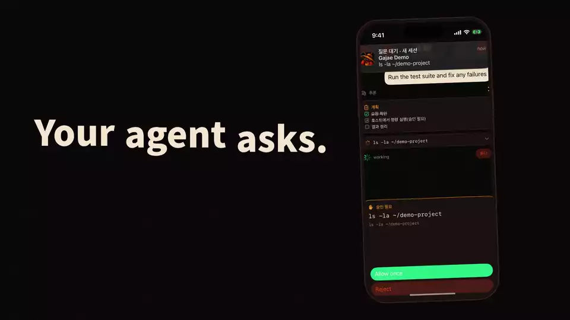
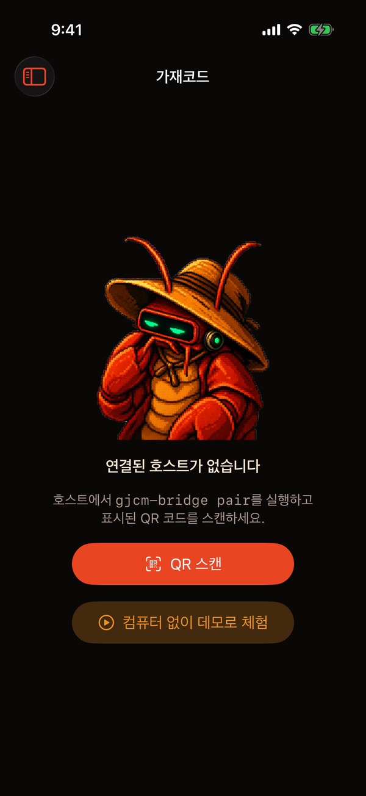
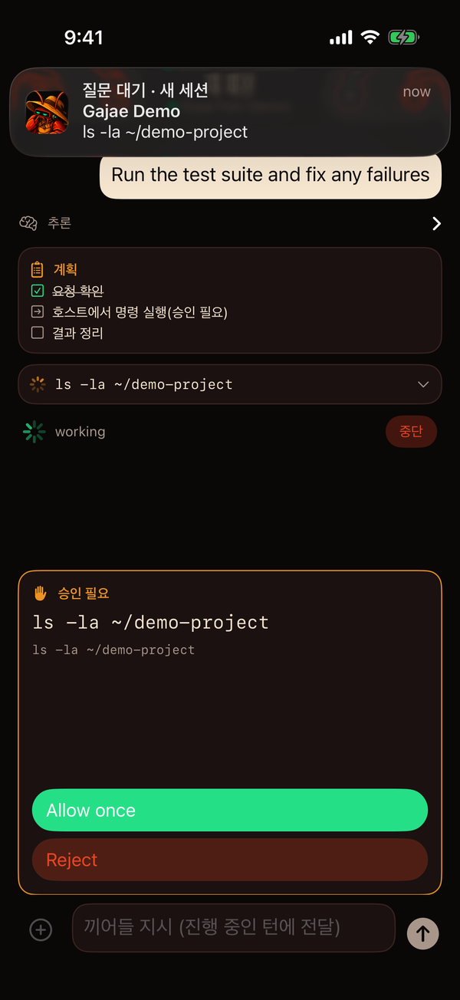
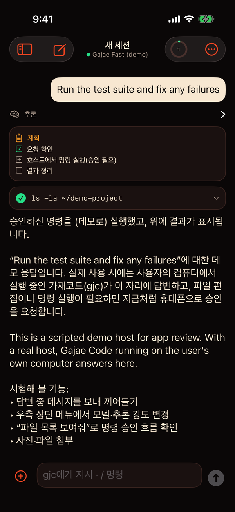
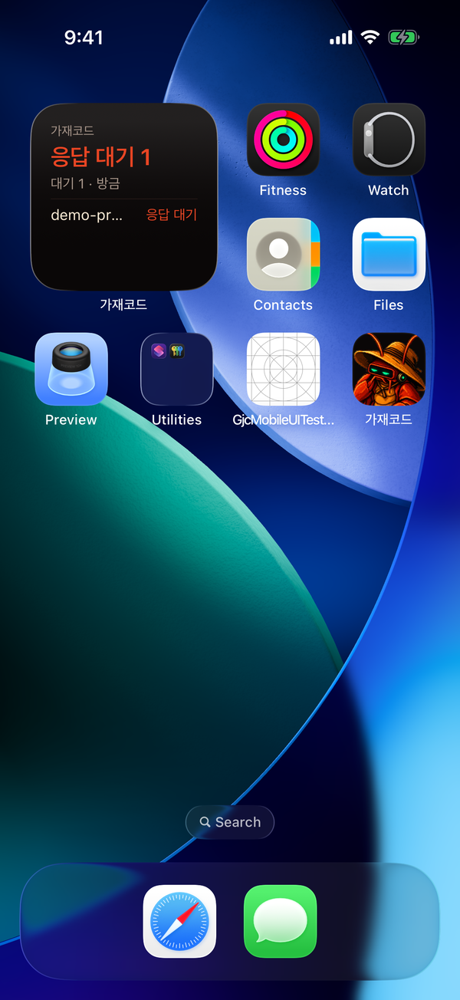

<!-- media:hero -->

# gajae-mobile

[English](README.md) · **한국어** · [简体中文](README.zh-CN.md)

**에이전트가 묻고, 휴대폰이 답합니다.**

gajae-mobile은 내 컴퓨터에서 돌아가는 코딩 에이전트 [가재코드(`gjc`)](https://github.com/Yeachan-Heo/gajae-code)를 휴대폰에서 다루는 iOS·Android 네이티브 앱입니다. 작업을 시작하고, 에이전트가 실행하려는 명령을 승인하고, 진행 중인 턴에 끼어들고, 어느 세션이 내 답을 기다리는지 홈 화면에서 바로 확인합니다. 에이전트와 세션, 모델 로그인 정보는 컴퓨터를 떠나지 않습니다. 휴대폰은 종단 간 암호화된 채널로 원격 조작만 합니다.

<p align="center"><a href="docs/media/reel.mp4"></a><br><sub>앱 실제 구동 화면을 녹화해 만든 영상입니다. <a href="docs/media/reel.mp4">소리 있는 MP4</a></sub></p>

<p align="center">
  
  
  
  
</p>
<p align="center"><sub>정해진 응답만 내는 데모 호스트에 연결한 iOS 앱(Simulator)의 실제 화면입니다.</sub></p>

## 기능

- **QR 코드 페어링.** `gjcm-bridge pair`가 10분 동안 한 번 쓸 수 있는 코드를 출력합니다. 찍거나 링크를 붙여 넣습니다.
- **에이전트와 대화.** 스트리밍 답변, 추론, 계획, 도구 호출과 결과, 사진·파일 첨부를 지원합니다.
- **휴대폰에서 승인.** 에이전트가 명령을 실행하려 하면 알림이 오고, *Allow once* 또는 *Reject*로 답합니다.
- **끼어들기와 중단.** 진행 중인 턴에 지시를 넣거나, 다음 지시를 예약하거나, 멈춥니다.
- **세션·모델·모드.** 디렉터리별로 묶인 저장 세션을 이어가고 검색하며, 모델·추론 강도·권한 모드를 바꿉니다.
- **홈·잠금화면 위젯.** 내 답을 기다리는 세션 수와 작업 중인 세션을 보여주고, 누르면 기다리는 세션이 바로 열립니다. 질문이나 명령 내용은 보여주지 않으며, 15분 넘게 새 상태를 받지 못하면 안심되는 0 대신 "확인 필요"를 표시합니다.
- **컴퓨터 없이 체험.** 데모 호스트를 설정한 빌드에는 아무것도 실행하지 않는 데모 호스트와 페어링하는 "데모로 체험" 버튼이 있습니다.

## 동작 방식

```
 휴대폰 (iOS / Android)                  내 컴퓨터
┌──────────────────────┐  gjcm-e2ee-v1  ┌────────────────────┐  ACP (stdio)  ┌──────────────────┐
│ gajae-mobile 앱      │ ◀─ WebSocket ─▶ │ gjcm-bridge        │ ◀───────────▶ │ gjc --mode=acp   │
│  페어링, 대화,       │  ws:// 또는 wss://│  기기 인증, E2EE   │               │  모델, 도구,     │
│  승인, 위젯          │  X25519+AES-GCM │  세션 다중화       │               │  세션 저장       │
└──────────────────────┘                 └────────────────────┘               └──────────────────┘
```

- 휴대폰과 브리지 사이의 모든 메시지는 앱 계층에서 암호화됩니다(X25519 키 합의, HKDF-SHA256, AES-256-GCM). 그래서 LAN이나 tailnet의 `ws://` 주소로 붙어도 TLS와 같은 보장이 성립합니다.
- 브리지는 `gjc --mode=acp` 프로세스 하나를 오래 유지하고 그 위에 여러 기기와 세션을 다중화합니다. 구독·API 인증 정보는 호스트의 `gjc`에만 있습니다.
- 휴대폰을 잃어버리면 호스트에서 `gjcm-bridge revoke <이름>`으로 즉시 끊습니다.

## 빠른 시작

컴퓨터에 [Bun](https://bun.sh)과 [가재코드](https://github.com/Yeachan-Heo/gajae-code)(`gjc`)가 `PATH`에 있어야 합니다.

```bash
git clone https://github.com/yazzang-homelab/gajae-mobile.git
cd gajae-mobile/bridge && bun install

# 1. gjc 옆에서 브리지 실행
bun src/cli.ts serve --host 0.0.0.0 --port 7787 --gjc "gjc --mode=acp"

# 2. 다른 터미널에서 1회용 페어링 코드(QR + gjcm:// 링크) 발급
bun src/cli.ts pair
```

앱을 열고 코드를 찍으면 연결됩니다. 브리지를 상시 실행하려면 예시 systemd 유닛 `deploy/gjcm-bridge.service`를 참고하세요.

### 앱 받기

아직 스토어 배포가 없어 소스에서 빌드합니다.

| 플랫폼 | 빌드 |
|---|---|
| Android 8.0+ | `cd android && ./gradlew :app:assembleDebug` 후 `app/build/outputs/apk/debug/app-debug.apk` 설치 |
| iOS 17+ | `cd ios && xcodegen generate && open GjcMobile.xcodeproj`, 팀을 지정하고 iPhone에서 실행 |

빌드할 때 `GJCM_DEMO_OFFER_URL`을 지정하면 직접 띄운 데모 호스트(`deploy/gjcm-demo.service`)로 데모 버튼이 켜집니다.

## 저장소 구성

| 경로 | 내용 |
|---|---|
| [`bridge/`](bridge/README.md) | 호스트 브리지(Bun, TypeScript): 프로토콜, 페어링, RPC, 데모 에이전트 |
| [`ios/`](ios/README.md) | Swift 6·SwiftUI 앱, WidgetKit 확장, 플랫폼 독립 `GjcMobileCore` 패키지 |
| [`android/`](android/README.md) | Kotlin·Jetpack Compose 앱, Glance 위젯 |
| `fixtures/` | 언어 간 공용 테스트 벡터. 세 구현이 모두 `e2ee-vector.json`을 재현합니다. |
| `deploy/` | 브리지와 데모 호스트용 예시 systemd 유닛 |
| `tools/` | 개발 서명 OTA 배포 도구, ACP 스모크 테스트 |

설계 문서: [구조와 프로토콜](docs/ARCHITECTURE.ko.md), [위젯](docs/WIDGET.ko.md), [`/btw` 사이드 대화](docs/BTW.ko.md), [배포와 CI](docs/RELEASE.ko.md), [Xcode Cloud 설정](docs/XCODE-CLOUD.ko.md).

## 개발

```bash
cd bridge && bun test && bun x tsc --noEmit -p .            # 브리지
cd android && ./gradlew :app:testDebugUnitTest :app:assembleDebug   # Android
cd ios/Core && swift test                                    # iOS 코어 (macOS 또는 Linux, Swift 6)
```

iOS 앱 빌드는 CI(macOS)에서 확인합니다. 기여는 이슈를 열고 `main` 대상 PR로 보내 주세요. 자세한 흐름은 [AGENTS.md](AGENTS.md)에 있습니다.

## 라이선스

[GNU Affero General Public License v3.0](LICENSE).
