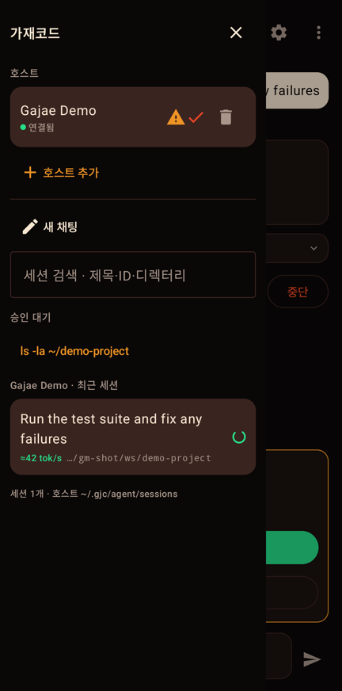

<!-- media:hero -->

# gajae-mobile

[English](README.md) · [한국어](README.ko.md) · **简体中文**

**智能体提问，手机作答。**

gajae-mobile 是 [Gajae Code（`gjc`）](https://github.com/Yeachan-Heo/gajae-code) 的 iOS 与 Android 原生伴侣应用。Gajae Code 是运行在你自己电脑上的编程智能体。你可以在手机上发起任务、批准智能体要执行的命令、介入正在进行的回合，并在主屏幕上直接看到哪个会话在等你回复。智能体、会话和模型登录信息都留在电脑上，手机只通过端到端加密的通道进行远程操作。

<p align="center"><a href="docs/media/reel.mp4"></a><br><sub>基于应用真实运行录屏制作。<a href="docs/media/reel.mp4">带声音的 MP4</a></sub></p>

<p align="center">
  
  
  
  
</p>
<p align="center"><sub>Android 应用连接脚本化演示主机时的真实截图。</sub></p>

## 功能

- **扫码配对。** `gjcm-bridge pair` 输出一次性配对码（10 分钟内有效），扫码或粘贴链接即可。
- **与智能体对话。** 流式回答、推理过程、计划、工具调用及其输出，支持图片和文件附件。
- **在手机上批准。** 智能体要执行命令时会先询问，你会收到通知，并选择 *Allow once* 或 *Reject*。
- **介入与中断。** 向正在进行的回合插入指令、排队下一条指令，或直接停止。
- **会话、模型、模式。** 继续按目录分组保存的会话并搜索，切换模型、推理强度和权限模式。
- **主屏幕与锁屏小组件。** 显示有多少会话在等你、哪些正在运行，轻点即可打开等待中的会话。不显示问题或命令内容；超过 15 分钟没有收到新状态时，显示"需要确认"，而不是让人安心的 0。
- **无需电脑即可体验。** 配置了演示主机的构建会提供"试用演示"按钮，连接一个不执行任何命令的脚本化主机。

## 工作原理

```
 手机 (iOS / Android)                    你的电脑
┌──────────────────────┐  gjcm-e2ee-v1  ┌────────────────────┐  ACP (stdio)  ┌──────────────────┐
│ gajae-mobile 应用    │ ◀─ WebSocket ─▶ │ gjcm-bridge        │ ◀───────────▶ │ gjc --mode=acp   │
│  配对、对话、        │  ws:// 或 wss:// │  设备认证、E2EE    │               │  模型、工具、    │
│  批准、小组件        │  X25519+AES-GCM │  会话多路复用      │               │  会话存储        │
└──────────────────────┘                 └────────────────────┘               └──────────────────┘
```

- 手机与桥接器之间的所有消息都在应用层加密（X25519 密钥协商、HKDF-SHA256、AES-256-GCM），因此即使通过局域网或 tailnet 的 `ws://` 地址连接，也能获得与 TLS 相同的保障。
- 桥接器长期维持一个 `gjc --mode=acp` 进程，并在其上复用多个设备和会话。订阅与 API 凭据只保存在主机的 `gjc` 中。
- 手机丢失时，在主机上执行 `gjcm-bridge revoke <名称>` 即可立即断开。

## 快速开始

电脑上需要 [Bun](https://bun.sh)，并且 [Gajae Code](https://github.com/Yeachan-Heo/gajae-code)（`gjc`）在 `PATH` 中。

```bash
git clone https://github.com/yazzang-homelab/gajae-mobile.git
cd gajae-mobile/bridge && bun install

# 1. 在 gjc 旁边运行桥接器
bun src/cli.ts serve --host 0.0.0.0 --port 7787 --gjc "gjc --mode=acp"

# 2. 在另一个终端生成一次性配对码（二维码 + gjcm:// 链接）
bun src/cli.ts pair
```

打开应用扫码即可连接。如需常驻运行，可参考示例 systemd 单元 `deploy/gjcm-bridge.service`。

### 获取应用

目前尚未上架应用商店，请从源码构建。

| 平台 | 构建 |
|---|---|
| Android 8.0+ | `cd android && ./gradlew :app:assembleDebug`，然后安装 `app/build/outputs/apk/debug/app-debug.apk` |
| iOS 17+ | `cd ios && xcodegen generate && open GjcMobile.xcodeproj`，设置你的开发团队后在 iPhone 上运行 |

构建时设置 `GJCM_DEMO_OFFER_URL`，即可让演示按钮连接你自己部署的演示主机（`deploy/gjcm-demo.service`）。

## 仓库结构

| 路径 | 内容 |
|---|---|
| [`bridge/`](bridge/README.md) | 主机桥接器（Bun、TypeScript）：协议、配对、RPC、脚本化演示智能体 |
| [`ios/`](ios/README.md) | Swift 6、SwiftUI 应用，WidgetKit 扩展，与平台无关的 `GjcMobileCore` 包 |
| [`android/`](android/README.md) | Kotlin、Jetpack Compose 应用，Glance 小组件 |
| `fixtures/` | 跨语言测试向量；三种实现都能复现 `e2ee-vector.json` |
| `deploy/` | 桥接器与演示主机的示例 systemd 单元 |
| `tools/` | 开发签名 OTA 发布工具、ACP 冒烟测试 |

设计文档为韩文：[架构与协议](docs/ARCHITECTURE.ko.md)、[小组件](docs/WIDGET.ko.md)、[`/btw` 旁路对话](docs/BTW.ko.md)、[发布与 CI](docs/RELEASE.ko.md)、[Xcode Cloud 设置](docs/XCODE-CLOUD.ko.md)。

## 开发

```bash
cd bridge && bun test && bun x tsc --noEmit -p .            # 桥接器
cd android && ./gradlew :app:testDebugUnitTest :app:assembleDebug   # Android
cd ios/Core && swift test                                    # iOS 核心（macOS 或 Linux，Swift 6）
```

iOS 应用由 CI（macOS）构建验证。欢迎先提 issue，再向 `main` 发起 PR，流程见 [AGENTS.md](AGENTS.md)。

## 许可证

[GNU Affero General Public License v3.0](LICENSE)。
